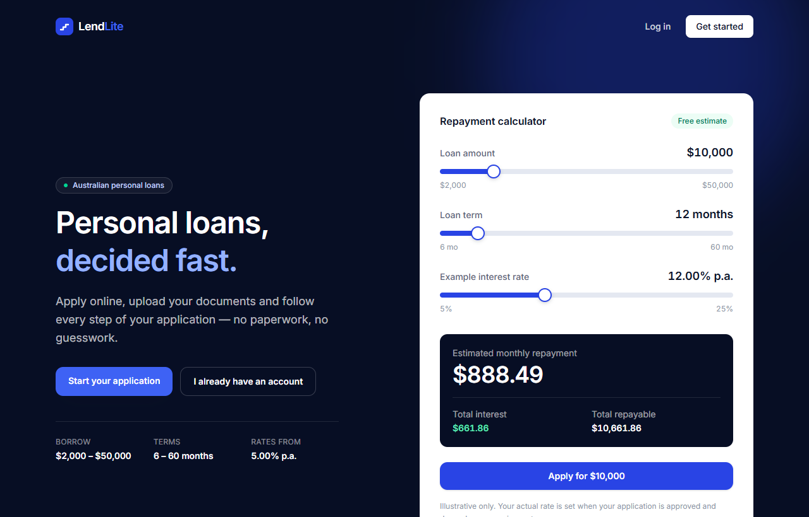
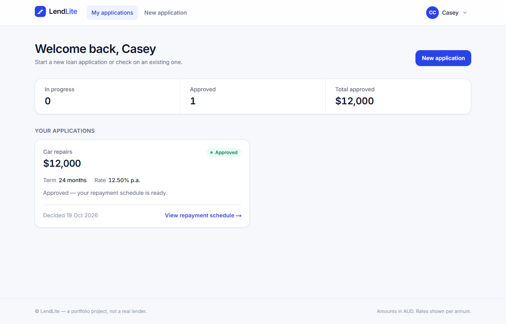
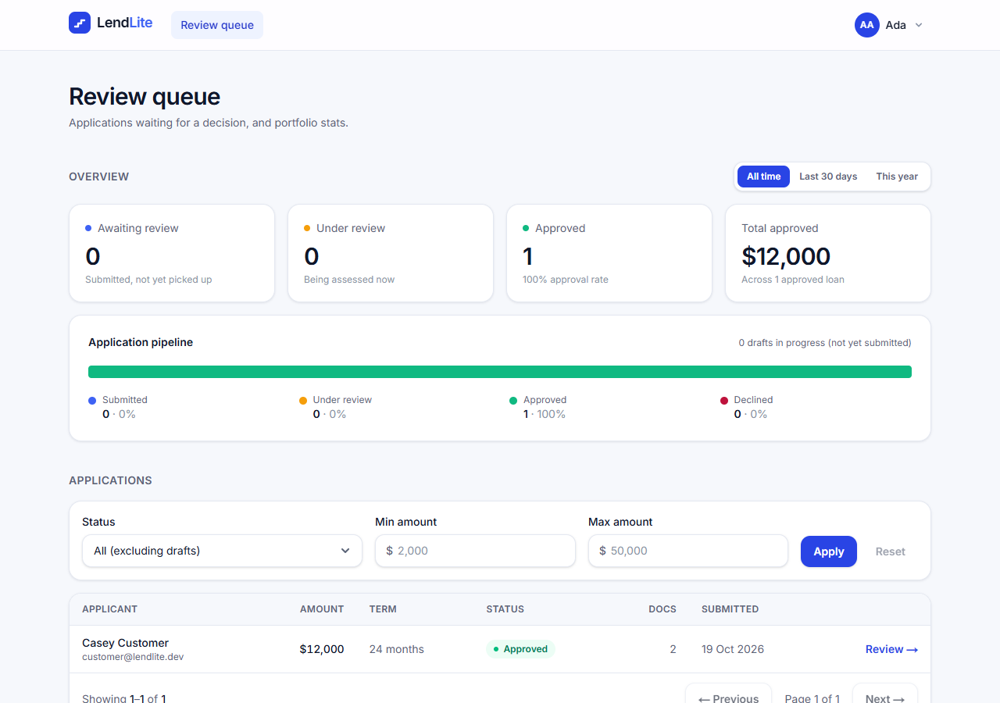
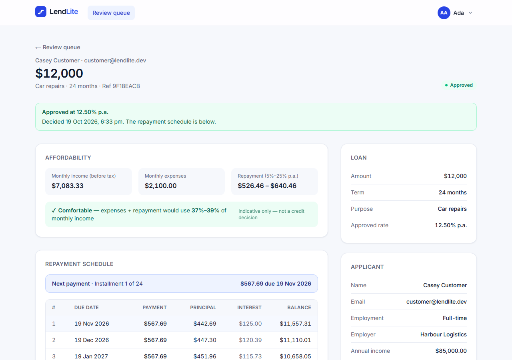
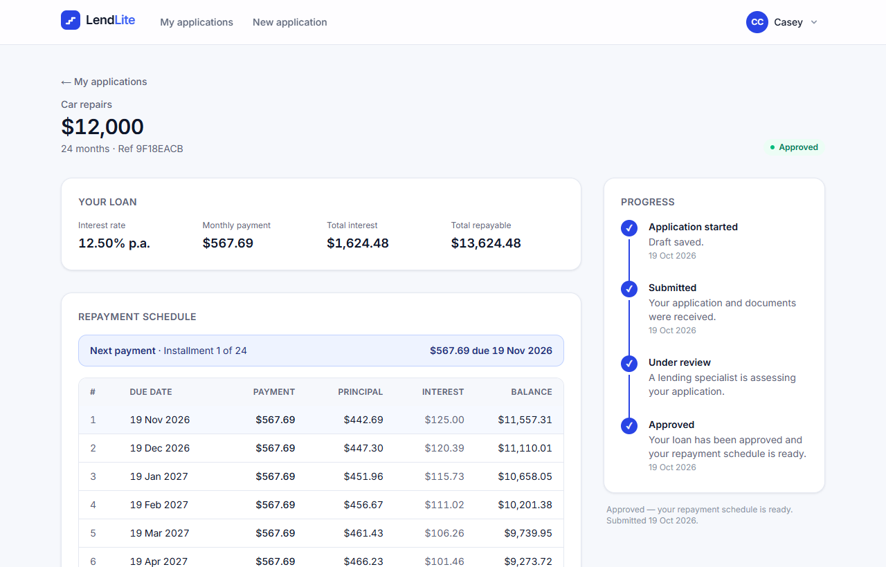
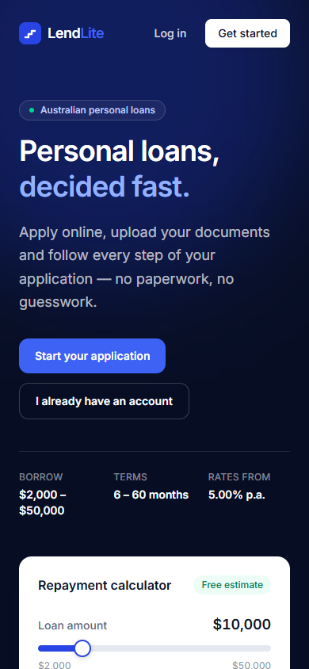
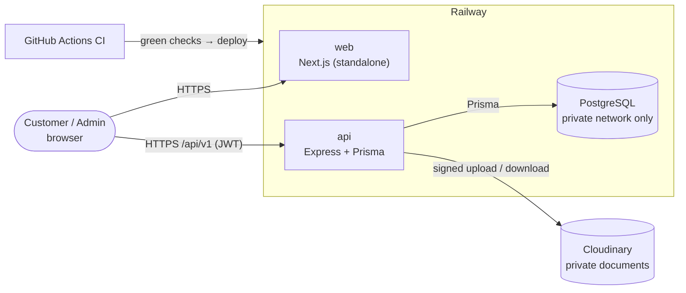
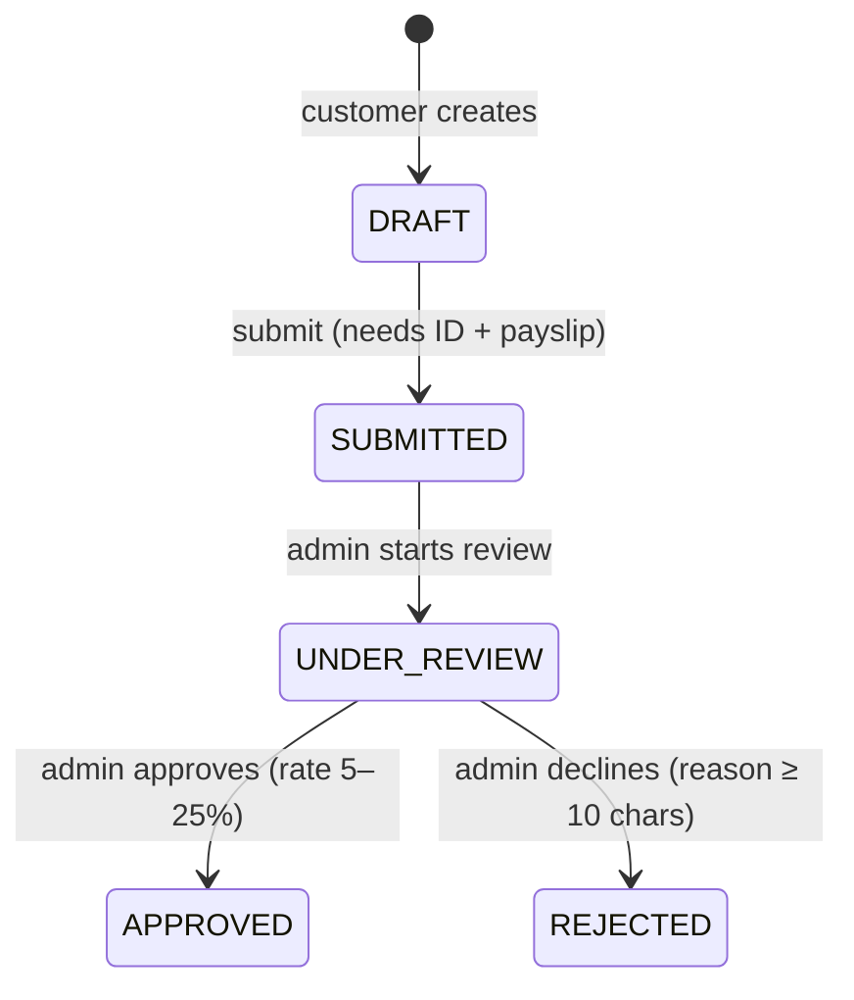

# LendLite — mini digital lending platform

[](https://github.com/JasDevPH/lendlite/actions/workflows/ci.yml)

Customers apply for a personal loan, upload documents and track their application. An admin reviews it, approves or declines it, and the system generates a repayment schedule on approval.

A full-stack TypeScript portfolio project, built to the standards of a real fintech codebase: integer-cent money, an audited status machine, atomic approvals, idempotent submits, private document storage, tests against a real database, and CI-gated deployment.

**Live demo:** https://web-production-a5b6c.up.railway.app

| Role | Email | Password |
|---|---|---|
| Customer | `customer@lendlite.dev` | `Customer1234` |
| Admin | `admin@lendlite.dev` | `Admin1234` |

> Demo data is shared, so anyone can create, approve or decline applications. It's a portfolio project, not a real lender.

---

## Screenshots

| Landing + repayment calculator | Customer dashboard |
|---|---|
|  |  |
| **Admin review queue (raw-SQL stats)** | **Admin application review** |
|  |  |
| **Approved loan with repayment schedule** | **Mobile** |
|  |  |

---

## Tech stack

| Layer | Choice |
|---|---|
| Language | TypeScript (strict) everywhere |
| Frontend | Next.js 16 (App Router), React 19, Tailwind CSS v4 |
| Backend | Node.js 20, Express 4 |
| Database | PostgreSQL + Prisma ORM (plus one raw SQL query via `$queryRaw`) |
| Validation | Zod, on every request body, query and params |
| Auth | JWT (HS256, 1 h) + bcrypt (cost 12) |
| Files | Multer → Cloudinary (private) in production, local disk in dev |
| Security | helmet, CORS allow-list, express-rate-limit |
| Logging | pino (JSON in production, pretty in dev) |
| Testing | Jest + Supertest against a real Postgres (90 tests) |
| DevOps | Docker (multi-stage), Docker Compose, GitHub Actions, Railway |

---

## Architecture



**Backend layering:** `routes → controller (HTTP only) → service (business rules) → Prisma`. Controllers never touch the database. Services throw `AppError(status, code, message)`, and one error handler formats every error the same way.

```
api/src/
├── app.ts            express app (no listen) — imported by tests
├── server.ts         starts the server, graceful shutdown
├── config/env.ts     Zod-validated env vars (fail fast at boot)
├── middleware/       auth, requireRole, validate, rateLimit, upload, errorHandler
├── modules/          auth · applications · documents · admin · calculator
├── lib/              prisma, logger, audit, storage (disk | cloudinary)
└── utils/            money, amortization (pure), AppError
```

### Loan status machine



Invalid transitions return `409 INVALID_STATUS_TRANSITION`. Every transition writes an audit log row.

---

## Design decisions

| Decision | Why |
|---|---|
| **Money as integer cents, rates as basis points** | Floats can't represent 0.1 exactly (`0.1 + 0.2 !== 0.3`), and money must be exact. 12.50% is stored as `1250`. |
| **Status machine in the service layer** | Business rules live in one place, whatever calls them (HTTP today, a queue tomorrow). Controllers stay thin. |
| **Approval in one DB transaction** | Status update + all repayment rows + audit row commit together or not at all. A conditional update means two admins deciding at once can't both win. |
| **Idempotent submit** (`Idempotency-Key` header) | A retried request (e.g. a flaky mobile connection) returns the original result instead of submitting twice. Reusing the key on another application → `409`. |
| **404, not 403, for other users' applications** | A 403 would confirm the ID exists. A 404 reveals nothing, so IDs can't be probed. |
| **Amortization as a pure function, last instalment absorbs rounding** | Easy to unit-test. Every cent is accounted for, so the final balance is exactly `$0.00`. |
| **Raw SQL for admin stats via `$queryRaw` tagged template** | Shows SQL (aggregation with `GROUP BY`). The tagged template sends values as bound parameters, so it's injection-safe, unlike `$queryRawUnsafe` or string concatenation. |
| **Private document storage behind the API** | Files are `authenticated` on Cloudinary (plain URLs return 401). The API checks ownership, fetches with a 60-second signed link and streams the bytes. Upload type is checked by MIME type **and** extension **and** magic bytes, and files get random storage names. |
| **`app.ts` separate from `server.ts`** | Tests import the app and call it with Supertest without opening a port. |
| **JWT in memory + `localStorage`** | Simple for a demo, but readable by any injected script (XSS). **In production I'd use an `httpOnly`, `Secure`, `SameSite` cookie**, which JavaScript can't read, plus CSRF protection. |
| **Fail fast on config** | Every env var is validated by Zod at boot. A missing or malformed secret stops the app with a clear message instead of failing on the first request. |
| **Rate limiting behind a proxy** | `trust proxy` is set only where a proxy exists (`TRUST_PROXY=1` on Railway), so limits apply per real client IP and can't be dodged by faking `X-Forwarded-For` locally. |

---

## Running locally

**Prerequisites:** Node 20+, npm, Docker.

### Option A — everything in Docker (fastest)

```bash
git clone https://github.com/JasDevPH/lendlite.git
cd lendlite
docker compose up --build
```

Open http://localhost:3000 and log in with the demo accounts above. Compose starts Postgres, runs migrations and seeds the demo users (one-shot job), then starts the API (`:4001`) and web (`:3000`). Stop with `docker compose down`, or add `-v` to also wipe the data.

### Option B — dev servers with hot reload

```bash
docker compose up -d db                 # Postgres on localhost:5433

cd api
cp .env.example .env                    # set JWT_SECRET to a long random string
npm install
npx prisma migrate dev
npx prisma db seed
npm run dev                             # http://localhost:4001/api/v1/health

cd ../web                               # in a second terminal
npm install
npm run dev                             # http://localhost:3000
```

### Tests

```bash
docker compose up -d db
cd api && npm test                      # uses a separate lendlite_test database
```

The test setup refuses to run against any database whose name doesn't end in `_test`, because the tests truncate every table.

### Scripts

| | API (`api/`) | Web (`web/`) |
|---|---|---|
| Dev server | `npm run dev` | `npm run dev` |
| Type check | `npm run typecheck` | `npm run typecheck` |
| Lint | — | `npm run lint` |
| Tests | `npm test` | — |
| Build | `npm run build` | `npm run build` |

---

## API

Base URL `/api/v1`. Success responses are `{ "data": … }`. Errors are `{ "error": { "code", "message", "details?" } }`.

| Method | Path | Auth | Description |
|---|---|---|---|
| GET | `/health` | — | Health check (includes DB) |
| POST | `/auth/register` | — | Create a customer account |
| POST | `/auth/login` | — | `{ token, user }`. Rate limited to 5/min per IP |
| GET | `/auth/me` | User | Current user |
| POST | `/calculator/quote` | — | Monthly payment + total interest |
| POST | `/applications` | Customer | Create a DRAFT |
| GET | `/applications` | Customer | My applications |
| GET | `/applications/:id` | Owner / Admin | Detail incl. documents + schedule |
| PATCH | `/applications/:id` | Owner | Update a DRAFT |
| POST | `/applications/:id/submit` | Owner | Submit (`Idempotency-Key` header) |
| POST | `/applications/:id/documents` | Owner | Upload (multipart `file` + `type`: ID / PAYSLIP / BANK_STATEMENT) |
| GET | `/documents/:id/download` | Owner / Admin | Download a document |
| GET | `/admin/applications` | Admin | Filter `?status=&minAmount=&maxAmount=&page=&pageSize=` |
| POST | `/admin/applications/:id/start-review` | Admin | SUBMITTED → UNDER_REVIEW |
| POST | `/admin/applications/:id/approve` | Admin | `{ annualRateBps }` → APPROVED + schedule |
| POST | `/admin/applications/:id/reject` | Admin | `{ reason }` → REJECTED |
| GET | `/admin/applications/:id/audit` | Admin | Audit trail |
| GET | `/admin/stats` | Admin | Counts + amounts per status (raw SQL), `?since=` |

**Status codes:** 400 validation · 401 missing/invalid token · 403 wrong role · 404 not found (or not yours) · 409 invalid transition / idempotency conflict · 413 file too large · 429 rate limited.

---

## CI/CD

Every push and pull request runs [GitHub Actions](.github/workflows/ci.yml):

1. **API:** typecheck → 90 tests against a Postgres service container → build → `npm audit` (production deps).
2. **Web:** lint → typecheck → `next build` → `npm audit`.
3. **Compose smoke test:** `docker compose up --build` on a clean runner, then checks that the seed ran, the DB is reachable, the demo users can log in, an upload survives an API restart, and the web app renders.

**Railway** watches `main` with **"Wait for CI"**, so it deploys only after all three jobs pass. Each service rebuilds only when its own folder changes. A new version takes traffic only after its health check passes, and database migrations run at container start.

---

## What I built

- **Backend:** REST API with layered architecture, Zod validation, JWT auth with role checks, a status machine with an audit trail, atomic approvals, idempotent submits, an amortization engine, secure file uploads with pluggable storage, and a raw-SQL stats endpoint.
- **Frontend:** a responsive Next.js app.
  - Live repayment calculator.
  - Four-step application wizard (state kept in the URL, draft saved from step 1).
  - Drag-and-drop document upload.
  - Repayment schedule with CSV export.
  - Admin dashboard with a colour-blind-safe pipeline chart, filterable review queue, approve/decline dialogs with a live repayment preview, and an audit timeline.
  - Loading, empty and error states on every data page.
- **Quality:** 89 backend tests (unit + integration on a real database), plus browser end-to-end checks for every UI feature during development.
- **DevOps:** multi-stage Docker images (non-root, health checks, graceful shutdown), Docker Compose for one-command local setup, GitHub Actions CI, and Railway deployment gated on CI with secrets kept out of git.

### What I'd do next

- `httpOnly` cookie sessions with refresh tokens instead of `localStorage`.
- ESLint for the API, and Playwright browser tests in CI.
- Email notifications on status changes (via a background job queue).
- Pin the same Postgres major version everywhere (production runs 18, dev/CI run 16).
